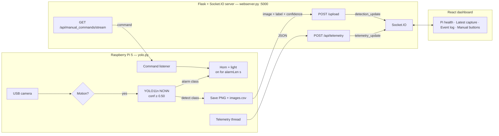

# How the System Fits Together

Written by Andy. I went through the code from last year's team (commit `77cb5ee`) to figure out how all the pieces talk to each other, since the README doesn't really explain it.

## The three programs

The system is three separate programs:

- **The detector** (`backend/yolo.py`) runs on the Raspberry Pi. It reads the camera, runs YOLO when something moves, turns on the horn and light, and sends detections and health data to the server.
- **The server** (`backend/webserver.py`) can run on the Pi or a laptop, on port 5000. It takes in uploads and telemetry from the Pi, saves the images, pushes live updates to the dashboard, and passes manual horn/light commands back to the Pi.
- **The dashboard** (`frontend/`) is the React site you open in a browser (port 5173 when running in dev). It shows Pi health, the latest detection, and an event log, and has buttons to manually fire the horn and light.

Last year's team ran the Pi and the server on different machines and connected them with Tailscale.

## Diagram

## How data moves

**Detections (Pi → server → dashboard).** When the detector sees something, it saves the frame to `static/<Label>-<timestamp>.png` and adds it to `images.csv` and `detection.txt`. Then a background thread sends the image to `/upload`. The server saves its own copy, adds it to its own `images.csv`, and sends a `detection_update` to every dashboard that's open.

**Telemetry (Pi → server → dashboard).** Every few seconds (10 in our config, 30 if it's not set) a thread sends CPU usage, CPU temp, memory, and disk usage to `/api/telemetry`. The server just passes it along to the dashboards as `telemetry_update`.

**Manual override (dashboard → server → Pi).** When you click the horn or light button, the dashboard sends a `manual_trigger` over Socket.IO. The server puts that command in a queue for every Pi connected to the command stream. The Pi keeps that stream open the whole time, and when a command shows up it pulses the horn or toggles the light.

## The detection loop

This is what `yolo.py` does on every frame:

1. Rotates the frame 90° because the camera was mounted sideways.
2. Checks for motion by comparing it to the last frame (grayscale, difference, blur, threshold, then count changed pixels). If not enough pixels changed, it skips YOLO.
3. If there's motion, it runs YOLO on that one frame. Any box at 50% confidence or higher whose class is in `detect` gets logged (at most once every `detInterval` seconds).
4. If the class is also in `triggerAlarm`, the horn and light turn on for `alarmLen` seconds.

It also re-reads `config.json` every frame, so you can change settings without restarting it.

## Where stuff gets saved

There's no database right now. Detection history ends up in a few places:

- On the Pi: `static/`, `images.csv`, and `detection.txt`. The CSV gets trimmed, but the trimming has a bug (see the setup guide), and old images never get deleted.
- On the server: its own `static/`, `images.csv` (last 10 rows), and `detection.txt`. Old images never get deleted here either.
- In each browser: the dashboard keeps its event log in `localStorage`, only the last 15 events, and only for that browser.

Parth added SQLite storage on his branch `parth-sqlite-detection-storage` (pushed Oct 28). It saves each upload to a `detections.db` table on the server, ignores duplicate uploads of the same detection, and refuses to overwrite an image file that already exists. It isn't merged into `main` yet and doesn't have a pull request, so for now everything above is still how `main` works. The CSV and the dashboard's event log also don't read from the database yet.
