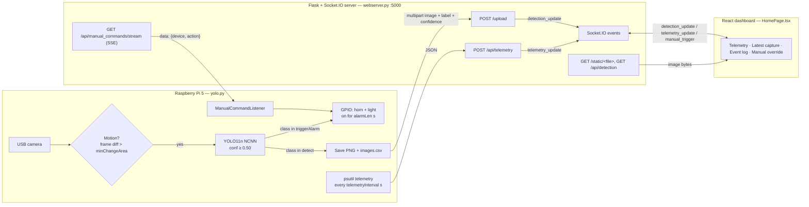

# System Architecture (inherited Bear-Be-Gone system)

Owner: Andy Vo · Last checked against code: commit `77cb5ee` (Nov 1, 2026)

The system has three programs that talk over HTTP and WebSockets:

| Program | File | Runs on | Job |
|---|---|---|---|
| Detector | `backend/yolo.py` | Raspberry Pi 5 (camera + GPIO) | Reads camera frames, runs YOLO when motion is seen, fires horn/light, uploads detections and telemetry |
| Server | `backend/webserver.py` | Any machine (Pi or laptop), port 5000 | Receives uploads/telemetry, stores images, pushes live updates to dashboards, relays manual commands to the Pi |
| Dashboard | `frontend/` (React + Vite) | Browser, port 5173 in dev | Shows Pi health, latest detection, event log; manual horn/light buttons |

Last year's team ran the Pi and the server on separate machines joined over Tailscale.

## Diagram

## Data flows

1. **Detection (Pi → server → dashboard).** `yolo.py` saves the frame to `static/<Label>-<timestamp>.png`, appends to `images.csv` and `detection.txt`, then a background thread POSTs the image to `/upload`. The server saves its own copy, appends to its own `images.csv`, and emits `detection_update` with an image URL to every connected dashboard.
2. **Telemetry (Pi → server → dashboard).** Every `telemetryInterval` seconds (config: 10; code default 30) a thread POSTs CPU %, CPU temperature, memory and disk use to `/api/telemetry`; the server re-emits it as `telemetry_update`.
3. **Manual override (dashboard → server → Pi).** A button emits Socket.IO `manual_trigger` `{device: horn|light, action: toggle}`. The server puts the command on the queue of every Pi connected to the SSE stream. The Pi's `ManualCommandListener` holds that stream open and pulses the horn (`hornPulseSeconds`) or toggles the light.

## Detection loop (yolo.py)

- Frame rotated 90° counter-clockwise (camera mounted sideways).
- Motion check: grayscale diff with the previous frame → Gaussian blur (`gaussianBlurKernel`) → threshold (`motionThresh`) → count changed pixels; inference runs only if the count exceeds `minChangeArea`.
- YOLO runs on that single frame; any box with confidence ≥ 0.50 whose class is in `detect` is logged (at most once per `detInterval` seconds); if the class is also in `triggerAlarm`, the horn and light switch on for `alarmLen` seconds.
- `config.json` is re-read every frame, so settings can change without a restart.

## Persistence

| Where | What | Limit |
|---|---|---|
| Pi `static/` + `images.csv` + `detection.txt` | Detection images and log | CSV trimmed (see setup guide, bug S-6); image files never deleted |
| Server `static/` + `images.csv` + `detection.txt` | Copy of uploaded images and log | CSV kept to last 10 rows; image files never deleted |
| Browser `localStorage['bear_event_log']` | Dashboard event log | Last 15 entries, per browser only |

There is no database; history lives in CSV/text files and in each browser separately. (Parth has a separate SQLite prototype, not yet merged.)
